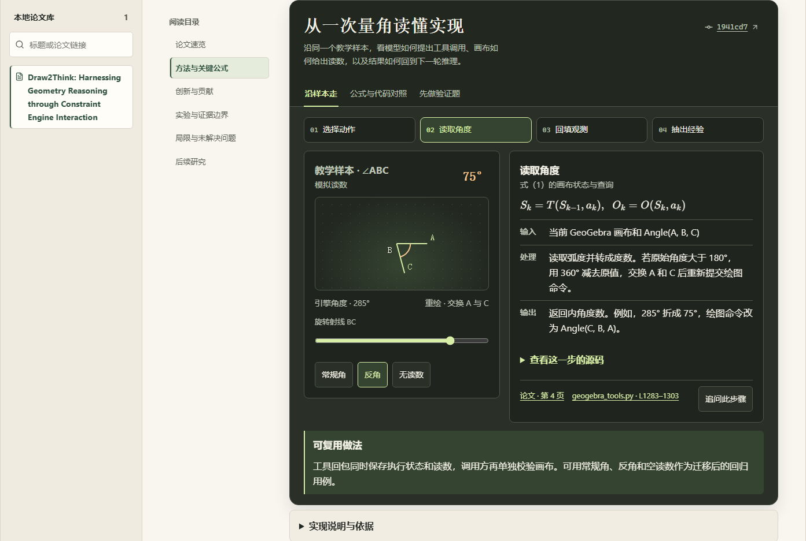
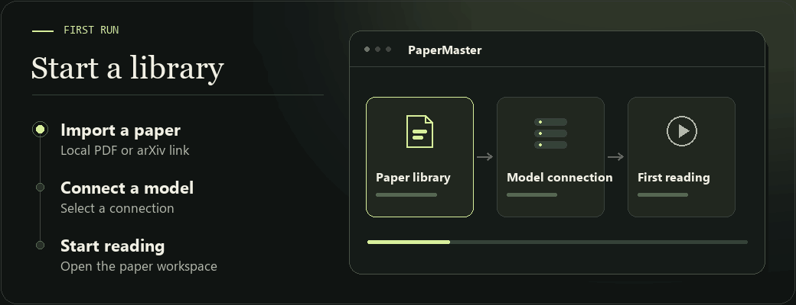
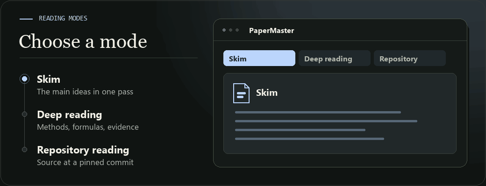
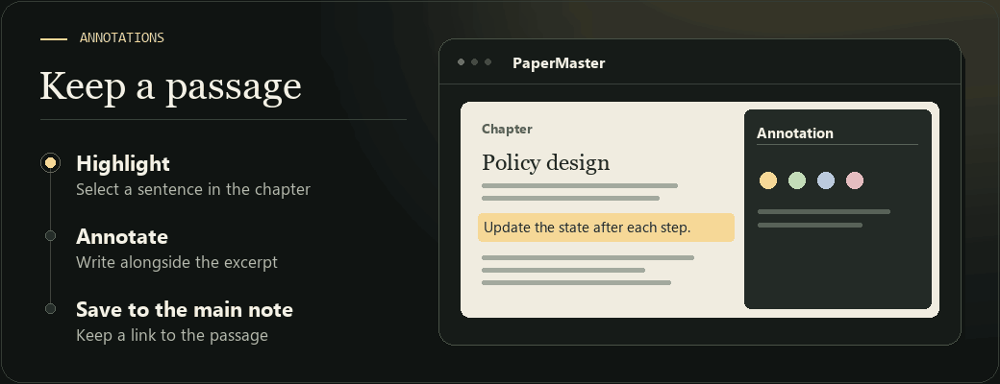
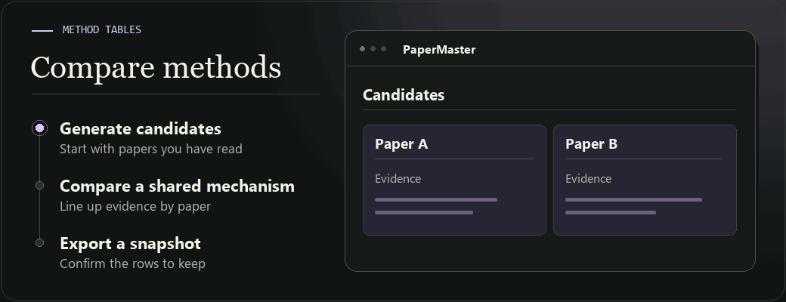

# PaperMaster

**Follow a research idea from paper to implementation.**

[简体中文](README.zh-CN.md) · [Install](#install) · [Tutorial](#tutorial) · [Releases](https://github.com/Kstheme/PaperMaster/releases) · [Homepage](https://kstheme.github.io/PaperMaster/)

PaperMaster is a local reading workspace. Import your own paper, read it in Chinese or English, and keep the passages, questions, and methods you decide are worth saving. The library stays on your machine.



*Repository reading for Draw2Think. One teaching sample connects the paper's state and observation model to the code that returns an angle.*

## Install

You need **Node.js 22.16 or later**. Repository reading also needs **Git**.

```sh
npm install -g papermaster-reader@latest
papermaster
```

The terminal prints a local address, usually `http://127.0.0.1:43947`, and opens it. To install one GitHub release instead of the latest package, download `papermaster-reader-<version>.tgz` from [Releases](https://github.com/Kstheme/PaperMaster/releases) and run `npm install -g ./papermaster-reader-<version>.tgz`. On Windows, use `npm.cmd` and `papermaster.cmd` if PowerShell blocks the shims.

A second library uses its own directory and port:

```sh
papermaster --data-dir ./my-library --port 43948
```

`papermaster --help` lists the flags. `--no-open` skips the browser.

## Tutorial

The short animations show how to start a reading, switch modes, save a passage, and export a method snapshot.

### 1. Open an empty library



A new data directory has no sample paper. The main area says **Start from an empty library**, with three steps: **Import a paper**, **Connect a model**, and **Start reading**.

You can do them in that order. Import a PDF with extractable text, or paste an arXiv link. Then add a model connection. Then choose **Skim** and start it. The guide closes and the paper workspace opens, with the job queued or running.

**Skip the guide** opens the workbench immediately. Refresh the page and the guide stays skipped for this directory. Start PaperMaster again with another `--data-dir` and the guide is back. An existing library, with papers and notes already in it, opens straight into the workbench.

### 2. Connect a model

Open **Model connection** in the top bar.

| Provider | What you need |
| --- | --- |
| Codex subscription | Codex CLI installed, then `codex login` |
| OpenAI, Claude, or Gemini API | Model name, and an API key in the system credential store or an environment variable ending in `API_KEY` |
| OpenAI-compatible endpoint | HTTPS base URL, or HTTP on localhost |

Add two connections if you want a spare. Mark one **Default**. You can **Check** a connection before a long reading.

A connection cannot be deleted while a job that uses it is queued or running. After the job finishes, **Delete** removes it. If it was the default, PaperMaster does not pick another one for you. The next reading waits until you choose a remaining connection. Older readings still show the model they used. **Resume with the selected connection** can continue a job on a different connection.

### 3. Choose how to read



On the paper's **Read** tab, pick one mode. They do not have to be done in order.

| Mode | Use it when |
| --- | --- |
| **Skim** | You want the paper in one pass |
| **Deep reading** | You want the method, formulas, and experiments, with interactive cards |
| **Repository reading** | The paper has a public GitHub repository, and you want the implementation at one commit |

Turn on interactive figures for a deep reading when you want architecture, formula, and experiment cards in the chapter. For repository reading, paste the repository URL. The commit is stored with that reading record.

**Guided reading**, **multi-paper comparison**, and **standalone questions** are not in the launcher yet. **Ask about this** from a finished chapter is available.

### 4. Use the cards

Architecture, formula, experiment, and repository steps use the same card: **title**, **actions**, **result**, **evidence**, and **save**. Architecture diagrams and formula demos use the darker engineering card, the same family as the repository walkthrough. Experiment tables stay on the lighter paper card.

In a finished deep reading:

1. On a formula card, change an input. The computed result updates. Open the evidence if the paper figure was captured. **Record this trial** writes the inputs and outputs into the main note.
2. On an architecture card, use **Next step** and **Previous step**. **Ask about this step** starts a follow-up with that step's title.
3. On an experiment card, filter by dataset, select two rows, and read the difference. Open the source figure or table.
4. On repository steps, move through the sample. **Formula and code** puts the paper statement next to the pinned source. Evidence for a practice step appears after you answer it.

The same cards work in a narrow window. Inputs stack, and buttons stay large enough to tap.

### 5. Keep a passage



In the chapter body, select a sentence. The toolbar offers yellow, green, blue, and pink, plus **Write a note**.

- Choose a color and keep reading. The highlight is stored on this reading record. Refresh, reopen the same record, and the color is on the same sentence. Another reading of the same paper does not show it.
- **Write a note** opens a side panel on a wide screen and a bottom sheet on a phone. You can see the excerpt while you write. **Save note** keeps it on the highlight. The main note does not change yet.
- **Add to the main note** copies the note, the excerpt, and a link back to the chapter. Open that link later and you return to the paper, the reading, and the highlight.
- **Delete note** removes the annotation and leaves the color. **Delete highlight** removes the color and the annotation together. Text already added to the main note stays.

### 6. Ask a follow-up

From a chapter, choose **Ask about this**. Ask a question, then a second one in the same thread. **Collapse** hides the thread. Open it again and both turns are still there. After a refresh, the thread is in the follow-up list until you delete it.

**Save to the main note** keeps the excerpt you select. **Delete this follow-up** removes the thread from the reading. The saved excerpt remains in the note.

### 7. Set the two languages

**Language settings** in the top bar has two controls.

**Interface language** changes the workspace: navigation, import, reading setup, cards, highlights, notes, model connections, follow-ups, and the method table. **Generation language** changes the language of a new deep reading, a new follow-up, and a new method candidate. Leave it on **Follow the interface** unless you want them to differ. An English interface can still generate a Chinese reading.

Switching the interface does not rewrite the paper, a finished reading, a saved follow-up, a method row, or a handwritten note.

### 8. Build a method table



Open **Method tables**. Create a topic, for example `bounded search`, and optionally say which problem the table is for. Select up to twelve paper versions that already have a reading. **Generate candidates**.

A candidate shows the structural problem, the mechanism, the conditions, the concrete practice, and a source you can check. An experiment record includes the metric, the comparison, the data or conditions, the result, and the source. Outcomes can be effective, no clear improvement, or failure. If the paper explains a mechanism and does not test the effect, the row is marked **The paper does not check the effect**. A paper that only shares keywords is left out. If nothing qualifies, the preview can be empty.

**Apply** saves each practice as its own row. Rows that share a mechanism after the wording is normalized sit side by side, one column per paper. Older rows that have only the original fields remain under **Not yet distilled into a meta-method**.

Select rows, **Preview delivery**, then confirm. **Note export** and **Auto Research export** are the same snapshot. Edit the table afterwards and download the snapshot again: it is unchanged. The snapshot does not decide a target task, predict a result, or design the experiment. See the [export format](docs/auto-research-export.md).

### 9. Back up

**Backup** in the top bar downloads a copy of the library. Papers, readings, notes, highlights, and method tables are files in the data directory:

| System | Default directory |
| --- | --- |
| Windows | `%LOCALAPPDATA%\PaperMaster` |
| macOS | `~/Library/Application Support/PaperMaster` |
| Linux | `$XDG_DATA_HOME/papermaster` or `~/.local/share/papermaster` |

Generation sends the relevant paper excerpts, and for repository reading the selected source excerpts, to the provider you chose. Sending figure crops is optional on the reading form.

## Develop from source

```sh
git clone https://github.com/Kstheme/PaperMaster.git
cd PaperMaster
npm ci
npm test
npm run build
npm start
```

`npm start` serves the built `dist/` interface. Run `npm run build` again after changing `src/`.

[Interactive reading design](docs/interactive-reading-design.md) · [Platform design](docs/platform-design.md) · [Report an issue](https://github.com/Kstheme/PaperMaster/issues)
