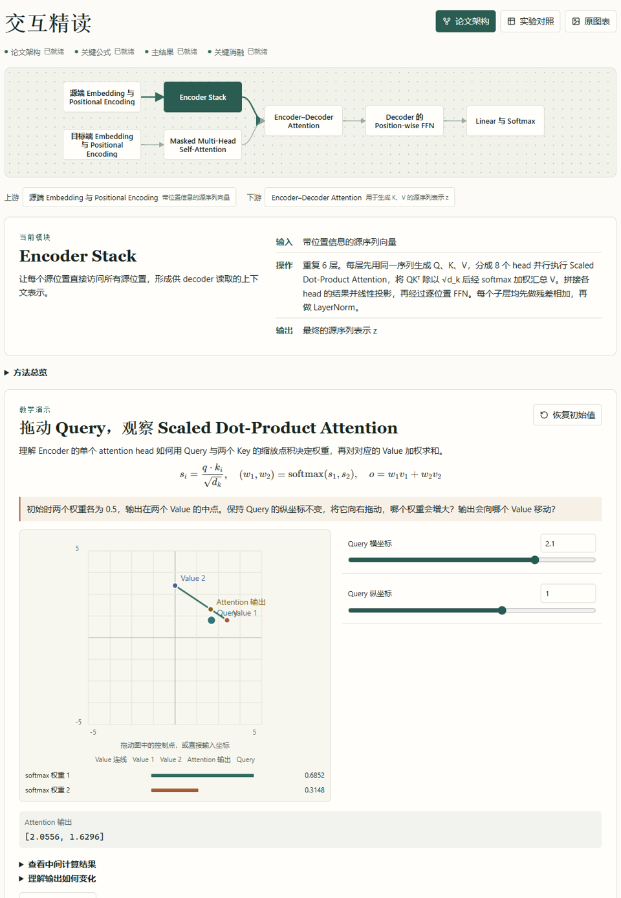

# PaperMaster

**顺着架构读论文，动手验证公式，再回到实验判断结论。**

[English](README.md) · [安装](#安装) · [快速上手](#快速上手) · [版本发布](https://github.com/Kstheme/PaperMaster/releases)

PaperMaster 是一个本地论文阅读工作台。导入 PDF 或 arXiv 链接，从可点击的架构图进入核心模块，修改公式输入观察输出，再用论文报告的实验结果核对自己的理解。阅读成果可以保存为 Markdown。

## 安装

**需要 Node.js 22.16 或更新版本。** 用 npm 从 GitHub Releases 直接安装预构建包：

```sh
npm install -g https://github.com/Kstheme/PaperMaster/releases/download/v0.2.0/papermaster-reader-0.2.0.tgz
papermaster
```

启动后会打开浏览器，并在终端打印本地访问地址。如果 Windows PowerShell 的执行策略阻止命令，使用 `npm.cmd` 和 `papermaster.cmd`。

## 快速上手

1. 打开 **模型连接**，添加一个模型。如果使用 **Codex 订阅**，先安装 Codex CLI，运行 `codex login` 登录 ChatGPT，再从本机 CLI 返回的列表选择模型。
2. 点 **导入论文**，上传带文字层的 PDF，或粘贴 arXiv 链接。
3. 选择 **完整精读**。点架构节点追踪输入和输出，在公式演算里改数值，再打开 **实验对照**，比较主结果和消融。
4. 把观察保存到主笔记，或导出本次结果为 Markdown。旧记录可以点 **生成交互版**，用同一论文版本创建新记录。



## 能做什么

| 功能 | 操作 |
| --- | --- |
| 架构探索 | 选择模块，沿连线查看上下游的数据流。 |
| 公式演算 | 拖动点或向量，或直接输入数值，观察中间量和输出实时更新。 |
| 实验对照 | 筛选主结果和消融，勾选对照行，并打开原图表核对。 |
| 引导精读 | 回答问题、查看反馈，下次接着上次的进度读。 |
| 仓库对照 | 关联公开 GitHub 仓库，在确定的提交版本上阅读实现。需要安装 Git。 |
| Markdown 笔记 | 保存实验对照与某次公式试算，也可以导出整次精读。 |

## 模型与数据

支持 Codex 订阅、OpenAI 兼容端点，以及 OpenAI、Claude、Gemini 的原生 API。API 凭证可通过环境变量提供，也可使用 Windows 或 macOS 的系统凭证库。

论文库、阅读记录和笔记保存在本机。生成时会向所选模型发送所需的论文片段。你可以在阅读表单选择是否发送图表裁片。导入要求 PDF 有可提取的文本，交互图表的覆盖范围取决于论文材料。

## 从源码运行

```sh
git clone https://github.com/Kstheme/PaperMaster.git
cd PaperMaster
npm ci
npm test
npm run build
npm start
```

运行 `papermaster --help` 查看本地服务选项。实现细节见 [交互阅读设计](docs/interactive-reading-design.md) 和 [平台设计](docs/platform-design.md)。问题反馈请提交到 [GitHub Issues](https://github.com/Kstheme/PaperMaster/issues)。
