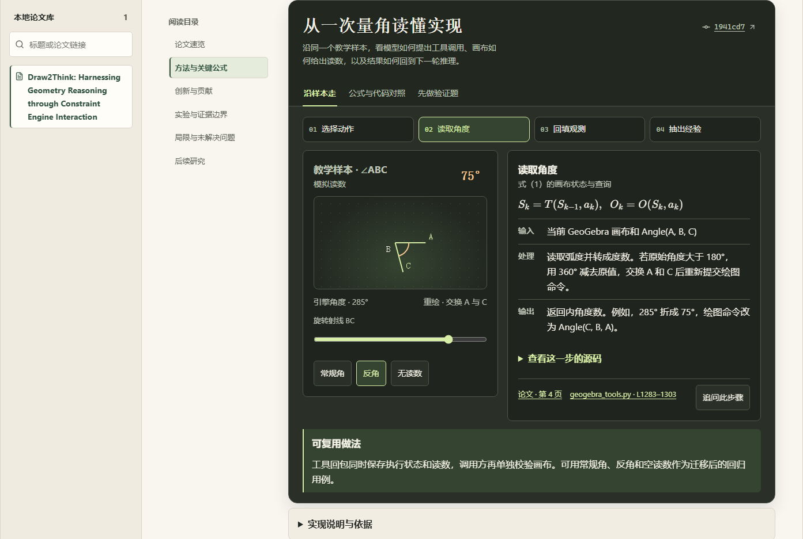
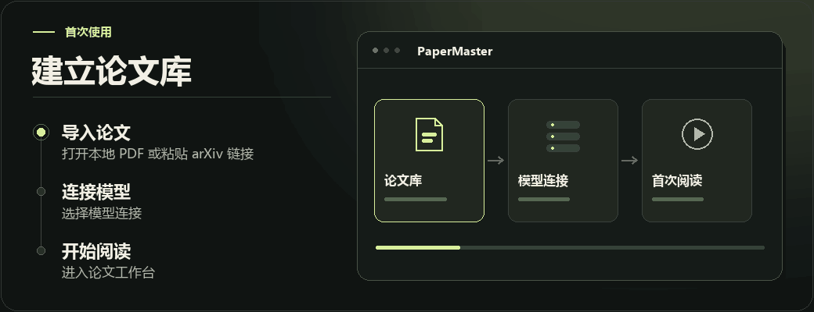
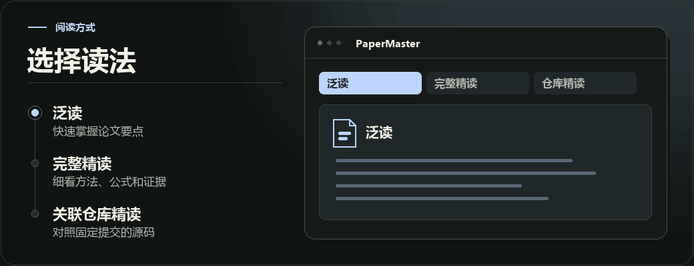
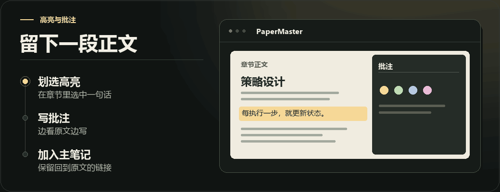
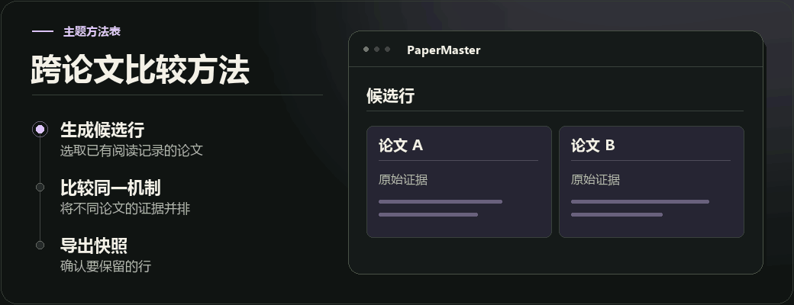

# PaperMaster

**从论文的方法，读到仓库里的实现。**

[English](README.md) · [安装](#安装) · [教程](#教程) · [版本发布](https://github.com/Kstheme/PaperMaster/releases) · [项目主页](https://kstheme.github.io/PaperMaster/)

PaperMaster 是本地的论文阅读工作台。导入自己的论文，用中文或英文阅读，把你决定留下的段落、追问和方法存在这台机器上。



*Draw2Think 的仓库精读。一个教学样本把论文里的状态与观测，连到实际返回角度的代码。*

## 安装

需要 **Node.js 22.16 或更新版本**。关联仓库精读还需要 **Git**。

```sh
npm install -g papermaster-reader@latest
papermaster
```

终端会打印本地地址，通常是 `http://127.0.0.1:43947`，并打开浏览器。如果要装某一份 GitHub 发布而不是最新的 npm 包，到 [Releases](https://github.com/Kstheme/PaperMaster/releases) 下载 `papermaster-reader-<版本>.tgz`，再运行 `npm install -g ./papermaster-reader-<版本>.tgz`。Windows 上如果 PowerShell 拦截脚本，改用 `npm.cmd` 和 `papermaster.cmd`。

第二份论文库用自己的目录和端口：

```sh
papermaster --data-dir ./my-library --port 43948
```

`papermaster --help` 列出参数。`--no-open` 不自动打开浏览器。

## 教程

下面的动图演示如何开始阅读、切换读法、保存批注，以及导出方法快照。

### 1. 打开一个空论文库



新的数据目录里没有示例论文。主区标题是「从空论文库开始」，三步是「导入论文」「连接模型」「开始阅读」。

可以按这个顺序做。导入一份能抽出正文的 PDF，或粘贴 arXiv 链接。然后添加模型连接。再选「泛读」并开始。引导关闭，进入这篇论文的工作台，任务处于排队或生成中。

「跳过引导」会立刻进入工作台。刷新后，这个目录仍然是跳过状态。用另一个 `--data-dir` 再启动，引导会重新出现。已经有论文和笔记的库会直接进入工作台。

### 2. 连接模型

点顶栏「模型连接」。

| 服务 | 需要准备 |
| --- | --- |
| Codex 订阅 | 安装 Codex CLI，并运行 `codex login` |
| OpenAI、Claude 或 Gemini API | 模型名，以及放在系统凭证或环境变量里的密钥。环境变量名以 `API_KEY` 结尾 |
| OpenAI 兼容端点 | HTTPS 的 Base URL。本机端点可以用 HTTP |

可以先加两条连接，把常用的那条标成「默认」。长阅读之前可以点「检查」。

使用这条连接的任务还在排队或运行时，不能删除它。任务结束后，点「删除」。如果删的是默认连接，PaperMaster 不会自动改选另一条。下次阅读前，你要从剩下的连接里自己选。旧阅读记录里仍看得到当时的模型名。「用所选连接续跑」可以把任务换到另一条连接上继续。

### 3. 选择读法



在论文的「阅读」页选择一种方式。三种方式不必按顺序做完。

| 方式 | 适合 |
| --- | --- |
| **泛读** | 先把论文过一遍 |
| **完整精读** | 看方法、公式和实验，并使用交互卡片 |
| **关联仓库精读** | 论文有公开 GitHub 仓库，要对照某一个提交上的实现 |

完整精读时打开交互图，章节里才会出现架构、公式和实验卡片。关联仓库精读要填写仓库地址。这个提交会跟这条阅读记录存在一起。

阅读入口里的「引导精读」「多篇比较」「专项解惑」还没有开放。已经写好的章节可以「就此追问」。

### 4. 使用卡片

架构图、公式演算、实验对照和仓库步骤是同一张卡片：标题、操作、结果、原始证据、保存。架构图和公式演算用深色工程卡片，和仓库精读是同一套。实验对照仍是浅色纸面卡片。

在一份完成的完整精读里：

1. 公式卡片上改一个输入，计算结果跟着变。如果截到了原图，可以打开证据。「记录本次试算」会把输入和输出写入主笔记。
2. 架构卡片上点「下一步」和「上一步」。「追问此步骤」会带上这一步的标题。
3. 实验卡片上按数据集筛选，勾选两行，看差值。打开来源图或表。
4. 仓库步骤里沿样本切换。「公式与代码对照」把论文表述和固定提交的源码放在一起。验证题答完以后，这一步的原始证据才出现。

窄窗口里这些卡片也能操作。输入改为上下排列，按钮保持可点的高度。

### 5. 留下一段正文



在章节正文里划选一句话。工具条上有黄色、绿色、蓝色、粉色，以及「写批注」。

- 只选颜色，然后继续读。高亮存在这一条阅读记录上。刷新并重新打开同一条记录，颜色还在原来的句子上。同一篇论文的另一条阅读记录看不到它。
- 「写批注」在宽屏是侧栏，在手机宽度是底部面板。写作时能看到原文摘录。「保存批注」只挂在高亮上，主笔记此时不变。
- 「确认加入主笔记」会写入批注、摘录，以及回到该章节的链接。以后点这个链接，会回到这篇论文、这条阅读和这处高亮。
- 「删除批注」去掉文字，留下颜色。「删除高亮」会把颜色和批注一起去掉。已经进入主笔记的文字还在。

### 6. 追问

在某一章点「就此追问」。先问一句，再在同一段对话里问第二句。「折叠追问」把面板收起。再打开，两轮都在。刷新后，只要没有删除，它仍在追问记录里。

「保存到主笔记」留下你选中的摘录。「删除此追问」会从这篇阅读里去掉整段对话。笔记里的摘录还在。

### 7. 两种语言

顶栏「语言设置」里有两个下拉框。

「界面语言」切换工作台：导航、导入、开始阅读、卡片、高亮、笔记、模型连接、追问和方法表。「生成语言」决定新的完整精读、新追问和新的方法候选用哪种语言。保持「跟随界面」时，生成语言与界面一致。英文界面也可以指定生成中文。

切换界面语言不会改写论文原文、已完成的精读、已保存的追问、方法表里的记录，以及手写笔记。

### 8. 建立主题方法表



打开「主题方法表」。新建主题，例如「有界搜索」，也可以写明这张表要解决的问题。选择最多 12 个已经有阅读记录的论文版本，点「生成候选行」。

一条候选包含结构性问题、作用机制、适用前提、具体做法，以及可以核对的出处。实验记录包含指标、对照、数据或条件、结果和出处。结论可以是有效、无明显改善或失败。论文只解释机制、没有做效果验证时，这一行会标成「原论文未验证效果」。只和主题共享关键词的论文不会入选。没有合格材料时，预览可以是零条。

「确认应用」后，每项具体做法单独成行。结构性问题和作用机制在整理后相同的记录会并排，每篇论文一列。只有旧字段的记录留在「尚未提炼元方法」里。

勾选行，点「预览交付」，再确认。「笔记导出」和「Auto Research 导出」是同一份快照。之后再改方法表，重新下载这份快照，内容不变。快照不判断目标任务，不预测结果，也不设计实验。格式见[交付快照说明](docs/auto-research-export.md)。

### 9. 备份

顶栏「备份」会下载论文库副本。论文、阅读记录、笔记、高亮和方法表都在数据目录里：

| 系统 | 默认目录 |
| --- | --- |
| Windows | `%LOCALAPPDATA%\PaperMaster` |
| macOS | `~/Library/Application Support/PaperMaster` |
| Linux | `$XDG_DATA_HOME/papermaster`，否则 `~/.local/share/papermaster` |

生成时会把相关论文片段发给你选的模型。关联仓库精读还会发送选定的源码片段。是否发送图表裁片，在开始阅读的表单里选择。

## 从源码运行

```sh
git clone https://github.com/Kstheme/PaperMaster.git
cd PaperMaster
npm ci
npm test
npm run build
npm start
```

`npm start` 打开的是已经构建的 `dist/` 界面。改了 `src/` 之后要再运行 `npm run build`。

[交互阅读设计](docs/interactive-reading-design.md) · [平台设计](docs/platform-design.md) · [问题反馈](https://github.com/Kstheme/PaperMaster/issues)
